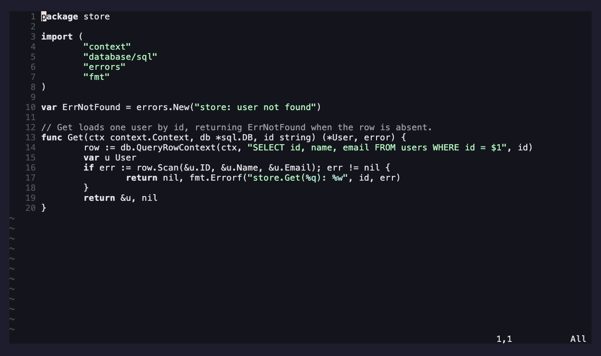

# ami-chat-split.nvim

A split-window chat UI for [ami](https://github.com/moosch/ami.nvim).

The chat panel ([`ami-chat.nvim`](https://github.com/moosch/ami-chat.nvim)) is a
floating window by default. This extension replaces it with a real **window
split** — a sidebar column with the transcript on top and the input below — by
providing the `chat_ui` capability that ami-chat's controller drives. Nothing in
ami core or ami-chat changes; the controller just renders through this instead.

It's a reference example of an ami extension and a complete implementation of the
`chat_ui` contract documented in ami's
[`docs/extensions.md`](https://github.com/moosch/ami.nvim/blob/main/docs/extensions.md).
It also hooks the `chat_turn_pre`/`chat_turn_post` lifecycle events (via `api.on`)
to show a `⟳ streaming…` indicator in the prompt winbar for the whole turn.

## Demo

The chat panel as a right-hand split, with a `⟳ streaming…` indicator while the
reply streams:



> Rendered from [`demos/chat-split.tape`](demos/chat-split.tape); see
> [`demos/README.md`](demos/README.md) to (re)generate it (needs ami-chat.nvim too).

## Requirements

- [ami.nvim](https://github.com/moosch/ami.nvim) — the runtime (extension API +
  `chat_ui` capability).
- [ami-chat.nvim](https://github.com/moosch/ami-chat.nvim) — the chat controller
  this renderer replaces the UI of. **Required**: without it there's no chat to
  render.

## Install

With [lazy.nvim](https://github.com/folke/lazy.nvim), install it alongside ami and
ami-chat, and register both in ami's `setup()`:

```lua
{
  "moosch/ami.nvim",
  dependencies = {
    "moosch/ami-chat.nvim",
    "moosch/ami-chat-split.nvim",
  },
  build = "make build",
  config = function()
    require("ami").setup({
      extensions = { require("ami-chat"), require("ami-chat-split") },
      -- optional (defaults shown):
      -- chat_split = { side = "right", width = 0.33, prompt_height = 6 },
    })
  end,
}
```

Then use ami's usual chat commands (`:AmiChat`, `:AmiAsk`, …) — they open in the
split. The in-panel keys match the floating UI: `<CR>` (normal mode) sends,
`<C-n>` starts a new session, `q`/`<Esc>` close.

## Configuration

Config lives under `chat_split` in ami's `setup()`:

| Key | Default | Meaning |
| --- | --- | --- |
| `side` | `"right"` | which side the column docks to (`"right"` or `"left"`) |
| `width` | `0.33` | column width: a fraction of the screen (`<=1`) or absolute columns (`>1`) |
| `prompt_height` | `6` | height of the input window, in lines |

> ami-chat's `chat.ui` options (`position`/`opacity`/…) apply to its **bundled**
> floating panel only; when this extension is active they're not used.

## License

[MIT](LICENSE)
